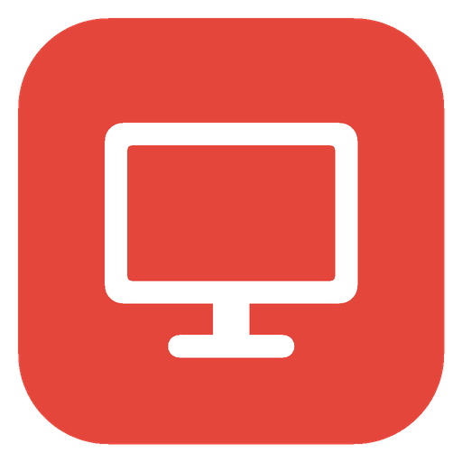

<div align="center">



# ManyDesk

**Remote desktop without servers.**<br>
Fast, end-to-end encrypted, peer-to-peer remote access for macOS, Windows, Linux and Android.

[](https://github.com/manydesk/many-desk/actions/workflows/build.yml)
[](https://github.com/manydesk/many-desk/releases/latest)
[](LICENSE)


[**Download**](https://github.com/manydesk/many-desk/releases/latest) ·
[Website](https://manydesk.github.io) ·
[How it works](#how-it-works) ·
[Security](#security) ·
[Build from source](#building-from-source)

</div>

---

ManyDesk is a remote desktop application in the spirit of AnyDesk, with one fundamental difference: **there is no ManyDesk server**. Computers find each other through public, independent networks, then connect directly over an encrypted QUIC link. Nothing you see, type or transfer passes through infrastructure we operate, because there is none.

It is a single native application written in Rust, with one code base for every platform.

## Highlights

- **No account, no server.** Each computer gets a permanent 9-digit address. Share it, accept the request, and you are connected.
- **Three kinds of session:** full **desktop** control, **file transfer** only, or a **terminal** only. The last two never capture the screen.
- **Built for speed.** Hardware H.264 (VideoToolbox, Media Foundation), a dedicated stream per video frame, and adaptive quality. An idle screen costs almost no bandwidth.
- **End-to-end encrypted.** TLS 1.3 with certificates pinned in both directions and a 6-digit code to verify that nobody is in the middle.
- **Unattended access** with a password, optional TOTP two-factor authentication and trusted devices. On Windows, a system service keeps the computer reachable at the sign-in screen.
- **Works on the local network without internet**, accepts a plain IP address instead of an ID, and can switch sleeping computers on with Wake-on-LAN.

## Features

| | |
|---|---|
| **Screen & control** | Multi-monitor, fit / 1:1 / stretch view, full-screen mode, key or text keyboard modes, automatic Cmd ↔ Ctrl mapping between macOS and Windows, remote resolution change, virtual displays (macOS) |
| **Communication** | Two-way voice (Opus), cameras on both sides, per-session chat |
| **Files & clipboard** | Two-pane file manager with drag and drop; two-way clipboard for text, rich text (HTML), images, files and folders — paste copied files straight into the remote session |
| **Session actions** | Ctrl+Alt+Del and special keys, remote restart with automatic reconnect, privacy mode, lock on disconnect, whiteboard, screenshots, switch sides, TCP tunnels |
| **Access control** | Per-viewer permissions changeable during the session, allow-list of IDs, up to 5 simultaneous viewers with color-coded pointers on the host |
| **Discovery** | Recent sessions with live online status, autocomplete in the address bar, LAN discovery, direct IP, Wake-on-LAN |
| **Languages** | English, Azerbaijani, Russian, Turkish |

## Download

Get the latest version from the [**Releases**](https://github.com/manydesk/many-desk/releases/latest) page. The app checks for updates on start and offers to install them.

| Platform | Package | Requirements |
|---|---|---|
| macOS | `ManyDesk-<version>-mac-universal.dmg` | macOS 13 or later, Apple Silicon and Intel |
| Windows | `ManyDesk-<version>-win-x64.exe` | Windows 10 or 11, 64-bit. Single executable, no installation needed |
| Linux | `.deb` or `.tar.gz`, amd64 and arm64 | X11 or Wayland |
| Android | `ManyDesk-<version>-android.apk` | Android 8.0 or later |
| iOS | Build from source | Controller only: iOS does not allow apps to share the screen |

Every release lists `SHA256SUMS` and carries signed build provenance, so you can verify a download came from this repository's CI:

```bash
gh attestation verify ManyDesk-<version>-mac-universal.dmg -R manydesk/many-desk
```

## Getting started

1. Install ManyDesk on both computers. Your address appears under **This desk**.
2. On the controlling side, type the other computer's address into the address bar and press **Connect**. Use the folder or terminal buttons next to it for a file transfer or terminal session.
3. On the other computer, review the request and the permissions, then press **Accept**.
4. Optionally, compare the 6-digit security code shown on both screens.

For unattended access, set a password (and optionally TOTP) under **Settings → Unattended access**.

### Permissions

| Platform | What the host needs |
|---|---|
| macOS | **Screen Recording**, **Accessibility** (for remote control) and **Local Network** (for LAN discovery) |
| Windows | Nothing by default. Install the service from Settings to be reachable at the sign-in screen |
| Android | ManyDesk's **Accessibility** service for remote control. On Android 13+ sideloaded apps may first need *App info → ⋮ → Allow restricted settings* |
| Linux | On Wayland, the desktop portal asks once for screen sharing |

## How it works

```
 Host                                                         Viewer
 ┌─────────────────────┐   request → accept → offer → answer  ┌─────────────────────┐
 │ screen capture      │ ◀── Nostr · MQTT · local network ──▶ │ address 482 913 557 │
 │ H.264 encoder       │     (signed, encrypted, a few KB)    │ H.264 decoder       │
 │ input injection   ◀─┼── video · input · audio · files ─────┼── mouse, keyboard   │
 └──────────┬──────────┘   (direct QUIC, TLS 1.3, P2P)        └──────────┬──────────┘
            │            discover the public address only               │
            └──────────▶  public STUN servers  ◀────────────────────────┘
                (only when no direct path exists: a TURN relay)
```

**Rendezvous.** A connection starts with a short handshake carried in parallel by 11 public Nostr relays, 4 MQTT brokers and the local network. Every message is signed (Schnorr, secp256k1) and verified by the app, so a relay can neither forge nor alter it. The first request is encrypted with a key derived from the target's address, everything after with a random session key. Delivery by any one network is enough, so blocking one does not break ManyDesk.

**MDP transport.** The session itself runs on MDP, ManyDesk's own protocol: QUIC (TLS 1.3, BBR congestion control) over a UDP path established by hole punching. Each video frame travels on its own stream, so a lost packet only delays that frame. Frames made obsolete by a newer keyframe are dropped instead of delivered late. Control and files use separate streams; voice uses datagrams.

**Video pipeline.**

| | Capture | Encode | Decode |
|---|---|---|---|
| macOS | ScreenCaptureKit | VideoToolbox (hardware) | VideoToolbox |
| Windows | DXGI Desktop Duplication | Media Foundation (Quick Sync, NVENC, AMF), OpenH264 fallback | Media Foundation (DXVA) |
| Linux | X11 MIT-SHM, Wayland portal | OpenH264 | VA-API via GStreamer |
| Android | MediaProjection | OpenH264 | OpenH264 |

Quality adapts per viewer: resolution follows the viewer's window, and frame rate and bitrate step down under CPU or network pressure before resolution does, which keeps text readable.

**NAT traversal.** Most connections are direct. Behind carrier-grade or symmetric NAT (common on mobile networks), configure a TURN relay under **Settings → TURN relay**. Cloudflare Realtime TURN (1,000 GB per month free) is supported with short-lived credentials, as is any standard TURN server. Only one side needs it.

## Security

- **End-to-end encryption.** Each side generates a certificate per session. Fingerprints travel inside the encrypted rendezvous, and QUIC accepts exactly those certificates in both directions.
- **Verification.** The 6-digit security code is derived from both certificates. Matching codes on both screens rule out a man in the middle.
- **Authentication.** The unattended-access password never crosses the network. The host stores only a PBKDF2-SHA256 key, and the viewer proves knowledge with an HMAC over a fresh nonce bound to both certificates (plus the TOTP code when enabled). Three failed attempts close the connection.
- **Least privilege.** Every capability — control, clipboard, files, audio, camera, terminal, restart, privacy mode, tunnels — is a separate permission the host grants per viewer and can revoke at any time.
- **Relays see nothing.** Rendezvous networks and TURN relays only carry encrypted traffic.

Please report vulnerabilities privately; see [SECURITY.md](SECURITY.md).

## Building from source

ManyDesk is a single Rust application in [`app/`](app). All desktop and Android packages can be built from a Mac.

**Requirements:** Rust (via rustup), Xcode Command Line Tools; for Windows `mingw-w64`, CMake and Go; for Linux Docker; for Android run `scripts/setup-android.sh`; for iOS full Xcode.

```bash
# run during development
cd app && cargo run --release

# tests
cd app && cargo test --release --lib

# packages into dist-native/
scripts/package-native.sh mac win linux
scripts/build-android.sh
scripts/build-ios.sh
```

`scripts/package-native.sh --bump minor|patch` raises the version in `app/Cargo.toml` first. On macOS, packages are signed with a stable local identity so that Screen Recording and Accessibility permissions survive updates; set `MANYDESK_SIGN_ID` to use a Developer ID instead.

### Continuous integration

Every push and pull request builds and tests all platforms with GitHub Actions. Pushing a `v<version>` tag that matches `app/Cargo.toml` publishes a release with all packages, checksums, build provenance attestations and the update manifest the app reads.

### Project layout

```
app/                   the application (Rust)
  src/ui.rs, ui/       interface (egui)
  src/core.rs, core/   sessions, requests, permissions, clipboard, terminal, tunnels
  src/mdp/             QUIC transport, NAT traversal, certificate pinning, TURN client
  src/rendezvous.rs    Nostr and MQTT rendezvous
  src/lan.rs           LAN discovery, direct IP, Wake-on-LAN
  src/media/           capture, H.264 encode and decode, camera
  src/platform/        permissions, Windows service, display modes, updates
  assets/i18n.json     translations
android/  ios/         platform shells
native/                macOS and Windows input helpers
scripts/               build and packaging
```

## Known limitations

- Packages are not yet signed with an Apple Developer ID or a Windows code-signing certificate. On macOS, if the downloaded app is reported as damaged, run `xattr -dr com.apple.quarantine /Applications/ManyDesk.app`. On Windows, SmartScreen may ask you to confirm: *More info → Run anyway*.
- iOS can only control other computers.
- Virtual displays are available on macOS only.
- Wake-on-LAN reaches computers on the same network, after they have been seen there once.

## Contributing

Contributions are welcome. See [CONTRIBUTING.md](CONTRIBUTING.md) for building, testing and guidelines.

## License

ManyDesk is licensed under the [Apache License 2.0](LICENSE).
